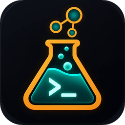
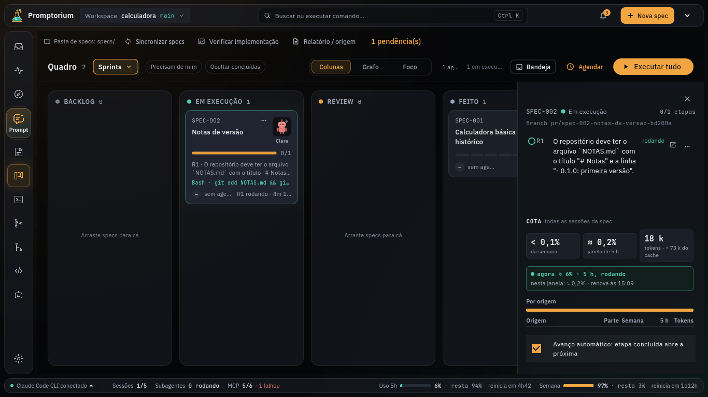
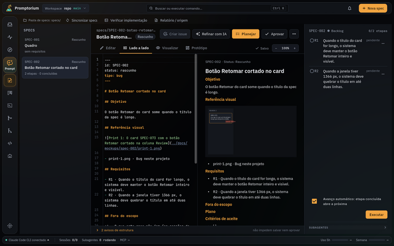
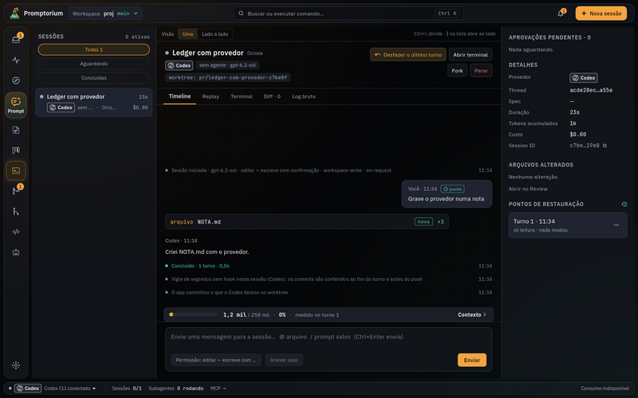
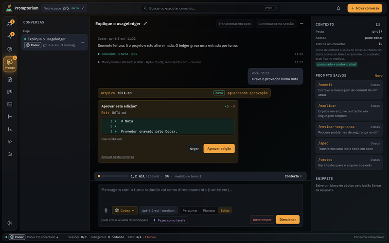
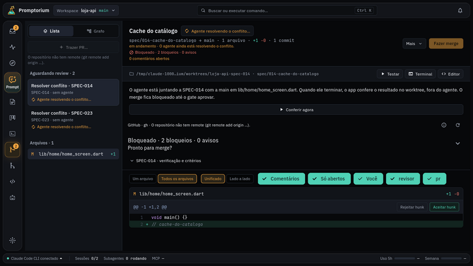
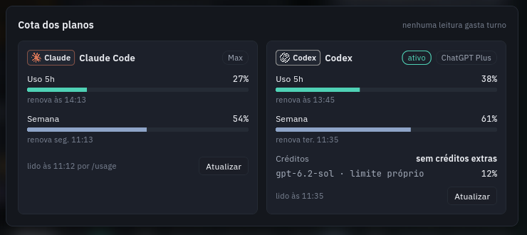

<p align="center">
  
</p>

<h1 align="center">Promptorium</h1>

<p align="center"><em>O laboratório de onde operam os comandos dos seus agentes.</em></p>

<p align="center">
  <a href="https://github.com/mayroncachina/promptorium/releases/latest"></a>
  <a href="https://github.com/mayroncachina/promptorium/actions/workflows/ci.yml"></a>
  <a href="https://github.com/mayroncachina/promptorium/actions/workflows/windows.yml"></a>
  <a href="https://github.com/mayroncachina/promptorium/releases"></a>
  <br>
  
  <a href="https://flutter.dev"></a>
  
</p>

<p align="center">
  <a href="#instalação">Instalação</a> ·
  <a href="#primeiros-passos">Primeiros passos</a> ·
  <a href="docs/guia/README.md">Guia de uso</a> ·
  <a href="CHANGELOG.md">CHANGELOG</a> ·
  <a href="https://github.com/mayroncachina/promptorium/releases">Releases</a>
</p>

<p align="center">
  
</p>

## O que é

O Promptorium é uma IDE desktop, feita em Flutter, para trabalhar com o **Claude Code CLI** e, desde a 0.23, também com o **Codex CLI**, orientado por specs. Você planeja o projeto, escreve e aprova specs, executa cada uma num `git worktree` próprio, etapa por etapa, e revisa e faz o merge sem sair do app.

É para quem já usa o Claude Code (ou o Codex) no terminal e quer organizar o trabalho dos agentes: várias tarefas em paralelo, cada uma isolada, com aprovações, testes e revisão num só lugar.

## Por que usar

- **Fluxo orientado por specs.** Cada mudança começa num Markdown com requisitos, plano, etapas e critérios de aceite. O agente executa o que foi aprovado, e não uma conversa solta.
- **Um worktree por spec.** Cada spec roda na própria branch (`pr/<slug>`), num worktree em `~/.promptorium/worktrees/`. A raiz do repositório fica livre para você, e várias specs andam em paralelo sem pisar uma na outra.
- **Gates entre as etapas.** Testes, lint e critérios são conferidos antes de seguir para a próxima etapa, com checkpoints para voltar ao início de qualquer uma.
- **Revisão e merge sem sair do app.** Diff por rodada e por etapa, comentários enviados ao agente, painel "Pronto para merge?", merge local guiado ou PR no GitHub.
- **A sua assinatura, sem API.** O app roda os CLIs que você já tem instalados, com o seu login, os seus agentes, skills e servidores MCP.

## Recursos

<table>
  <tr>
    <td width="50%" valign="top">
      <h3>📝 Specs</h3>
      <p>Editor de Markdown lado a lado, refinar com IA, Planejar, protótipo de telas e Aprovar. O planner propõe stack e roadmap de specs a partir de uma pasta, de um modelo ou de um clone.</p>
      
    </td>
    <td width="50%" valign="top">
      <h3>🧭 Quadro e Autopilot</h3>
      <p>Specs aprovadas viram cartões em Backlog, Em execução, Review e Feito, com Colunas, Grafo de dependências e Foco. O Autopilot executa as specs prontas com limite de paralelismo, orçamento diário e agendamento.</p>
      
    </td>
  </tr>
  <tr>
    <td width="50%" valign="top">
      <h3>⚡ Sessões ao vivo, com Claude Code ou Codex</h3>
      <p>Timeline, aprovações, perguntas do agente, terminal, Replay, diff, fork e lado a lado. Novo na 0.23: sessões com o Codex em worktree, com interromper, retomar e fork.</p>
      
    </td>
    <td width="50%" valign="top">
      <h3>💬 Prompt</h3>
      <p>Conversas sem worktree para perguntar, planejar e editar, com anexos e prompts salvos. A resposta vira spec ou sessão. O Codex entra nos modos Perguntar, Planejar e Editar, com aprovação das edições.</p>
      
    </td>
  </tr>
  <tr>
    <td width="50%" valign="top">
      <h3>🔍 Review e merge</h3>
      <p>Diff da spec inteira, comentários ao agente, revisor automático, critérios de aceite, conflito resolvido pelo agente, merge local guiado e PR no GitHub com acompanhamento dos checks.</p>
      
    </td>
    <td width="50%" valign="top">
      <h3>📊 Cota dos planos</h3>
      <p>O rodapé mostra o uso do plano do provedor ativo (janela de 5 h e semana), com o detalhe do Claude Code e do Codex lado a lado e aviso de limite antes de abrir uma sessão.</p>
      
    </td>
  </tr>
</table>

Também tem: árvore de arquivos, editor, terminal e busca (Código), releases e o que falta lançar (Repositório), agentes, skills e servidores MCP do Claude Code (Ferramentas), paleta de comandos (Ctrl+K), notificações e ícone na bandeja. Detalhes de cada tela no [Guia de uso](docs/guia/README.md).

## Como funciona

O Promptorium não chama nenhuma API. Cada execução é um processo do CLI do provedor, e por isso ele usa a assinatura ou a conta que você já tem em cada um.

- **Claude Code**: cada sessão é um processo `claude -p --input-format stream-json --output-format stream-json`. A timeline é montada a partir do stream-json, e as aprovações de ferramenta chegam e são respondidas pela própria stdin/stdout (`--permission-prompt-tool stdio`).
- **Codex**: o app conversa com o `codex app-server`. Os eventos dos dois provedores viram os mesmos cartões na timeline, no Replay e no medidor de contexto.

O provedor é escolhido no rodapé, no Prompt e na Nova sessão, e nunca troca no meio de uma execução. Nesta versão o Codex roda no **Prompt** e nas **Sessões**; a execução de specs, o review automático e o Comparar com o Codex vêm nas próximas versões (veja o [Roadmap](#roadmap)). Onde o Codex ainda não funciona, a tela mostra "Só Claude Code".

Mais detalhes em [Como funciona](docs/guia/como-funciona.md).

## Requisitos

| | |
|---|---|
| Sistema | Linux x64, Ubuntu/Debian 22.04 ou mais novo. Há um `.zip` do Windows experimental, sem suporte oficial. |
| Claude Code CLI | instalado à parte, com o seu usuário e com login feito |
| Codex CLI (opcional) | versão 0.170 ou mais nova, com `codex login` feito |
| git | obrigatório (worktrees, diff, merge) |
| `gh` (opcional) | habilita PRs no Review |
| Memória | 4 GB no mínimo, 8 GB ou mais recomendado (cada sessão aberta é um processo do CLI) |

Requisitos de vídeo, processador, tela e o custo do tema Vidro: [Instalação](docs/guia/instalacao.md#requisito-mínimo).

## Instalação

Baixe o pacote da [última release](https://github.com/mayroncachina/promptorium/releases/latest):

| Arquivo | Uso |
|---|---|
| `promptorium_<versão>_amd64.deb` | Ubuntu/Debian: `sudo apt install ./promptorium_<versão>_amd64.deb`. Instala em `/opt/promptorium`, com o comando `promptorium`, atalho no menu e ícones. |
| `promptorium-<versão>-linux-x64.tar.gz` | Portátil: extrair e rodar `./promptorium`, sem atalho no menu. |
| `promptorium-<versão>-windows-x64.zip` | Windows, experimental. |

O Claude Code CLI é instalado à parte, com o seu usuário:

```bash
curl -fsSL https://claude.ai/install.sh | bash
```

Para usar o Codex, instale o [Codex CLI](https://github.com/openai/codex) (0.170 ou mais novo) e rode `codex login` no terminal.

O app verifica uma vez por dia se há release nova e se atualiza pelo cartão do Sobre (F1). Instalação a partir do código (`scripts/install.sh`), Flatpak e onde ficam os seus dados: [Instalação](docs/guia/instalacao.md).

## Primeiros passos

1. **Abra um projeto.** Na tela Começar, escolha "Abrir pasta existente", "Criar projeto novo" (com o planner propondo stack e roadmap) ou "Clonar de uma URL".
2. **Escreva uma spec.** Em **Nova spec**, descreva o que quer; refine com IA, use Planejar e, quando estiver bom, **Aprovar**.
3. **Execute no Quadro.** A spec aprovada vira um cartão. **Executar** cria o worktree da spec e abre uma sessão por etapa, com o gate entre elas.
4. **Acompanhe a sessão.** Aprove ferramentas, responda às perguntas do agente e veja o diff ao vivo.
5. **Revise e faça o merge.** No Review, comente o diff, confira o painel "Pronto para merge?" e faça o merge local ou abra o PR.

Cada passo, com as telas, no [Guia de uso](docs/guia/README.md).

## Roadmap

O Codex chega por ondas ([épico #332](https://github.com/mayroncachina/promptorium/issues/332)):

- [**0.24.0**](https://github.com/mayroncachina/promptorium/milestone/4): memória e fluxo de specs, incluindo executar spec e review automático com o Codex.
- [**0.25.0**](https://github.com/mayroncachina/promptorium/milestone/5): ecossistema do provedor (AGENTS.md, skills, MCP e agentes no Codex).
- [**0.26.0**](https://github.com/mayroncachina/promptorium/milestone/6): multi-provedor (Comparar Claude × Codex, orquestrador e Replay com o Codex).

Todos os marcos: [milestones](https://github.com/mayroncachina/promptorium/milestones). O que já saiu: [CHANGELOG](CHANGELOG.md).

## Desenvolvimento

Com o Flutter 3.47.7 (a versão da CI) e o toolchain Linux:

```bash
sudo apt install clang cmake ninja-build pkg-config libgtk-3-dev \
  libsqlite3-dev libx11-dev libxi-dev
flutter pub get
flutter run -d linux
flutter analyze && flutter test
```

Build e pacotes:

```bash
flutter build linux --release
scripts/package.sh <versão>       # .deb e .tar.gz em dist/
```

Requisitos completos, banco e migrações, testes de integração, desempenho, CI e release: [Desenvolvimento](docs/guia/desenvolvimento.md).

## Como contribuir

1. Abra uma [issue](https://github.com/mayroncachina/promptorium/issues) descrevendo o problema ou a ideia. Mudanças maiores viram uma spec em [`docs/specs/`](docs/specs/README.md).
2. Crie uma branch a partir da `main` e abra o PR para a `main`. O CI roda `flutter analyze` e `flutter test` em todo PR.
3. Use mensagens de commit no formato [Conventional Commits](https://www.conventionalcommits.org/pt-br/) (`feat:`, `fix:`, `docs:` …): o CHANGELOG sai delas, pelo `git cliff`.
4. PRs que mudam telas levam capturas do app.

## Documentação

| | |
|---|---|
| [Guia de uso](docs/guia/README.md) | Como funciona e o que cada tela faz |
| [Instalação](docs/guia/instalacao.md) | Pacotes, script, Flatpak e atualizações |
| [Índice da pasta `docs/`](docs/README.md) | Specs, planos, pesquisa, débito técnico e mockups |
| [CHANGELOG](CHANGELOG.md) | Notas das versões |
| [Releases](https://github.com/mayroncachina/promptorium/releases) | Pacotes para baixar |
