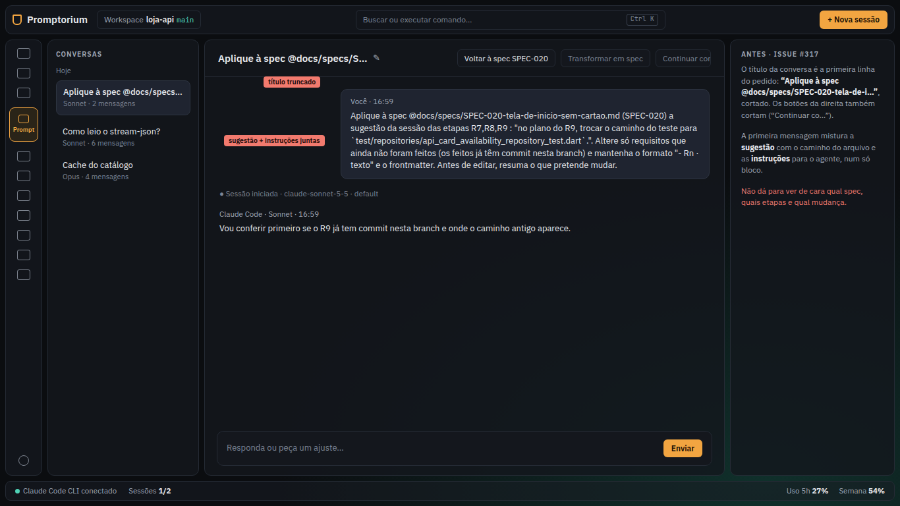
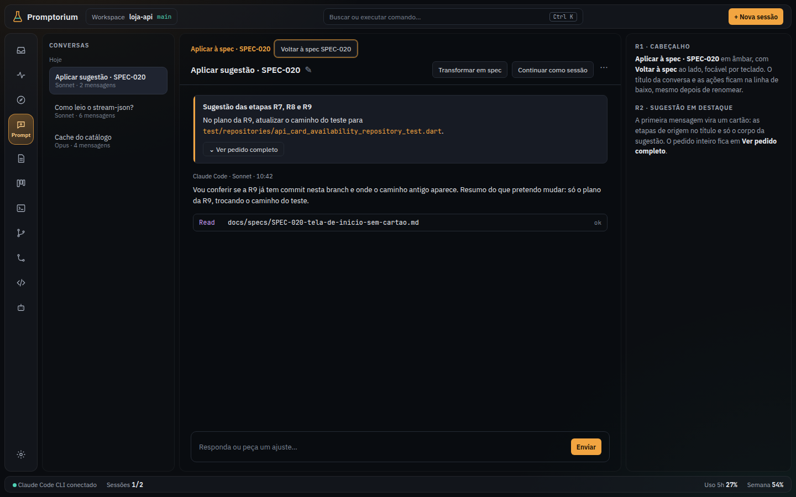
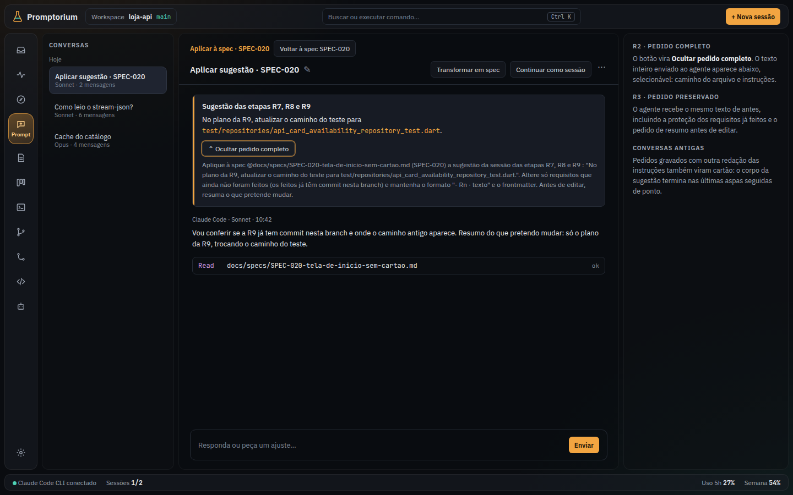
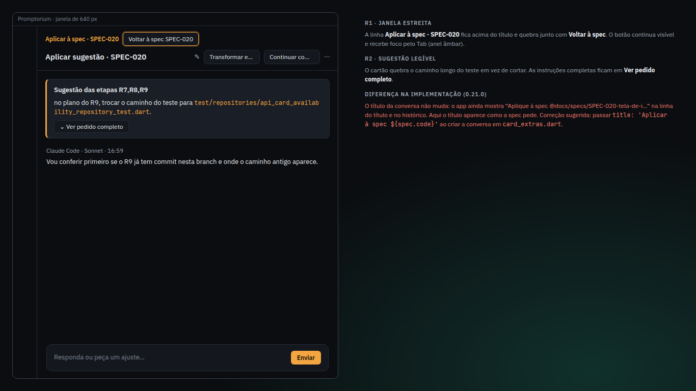
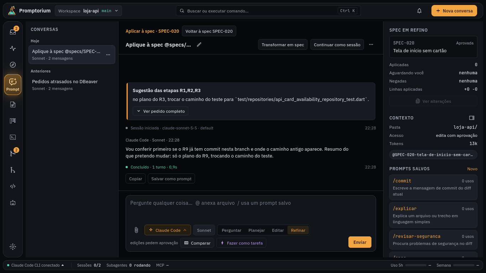
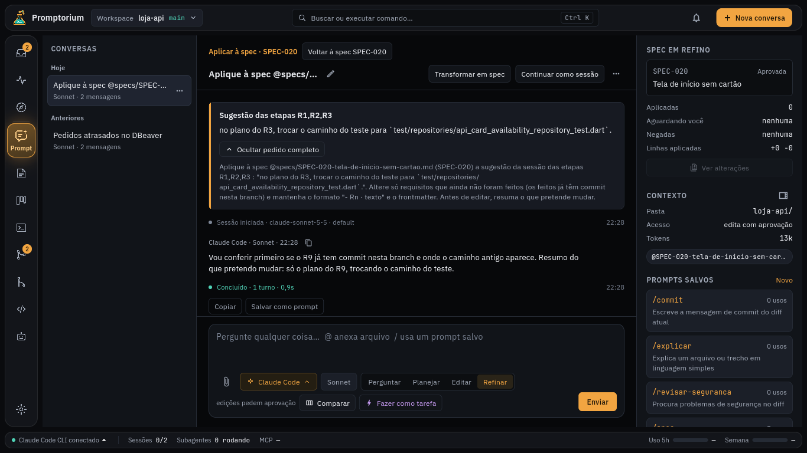
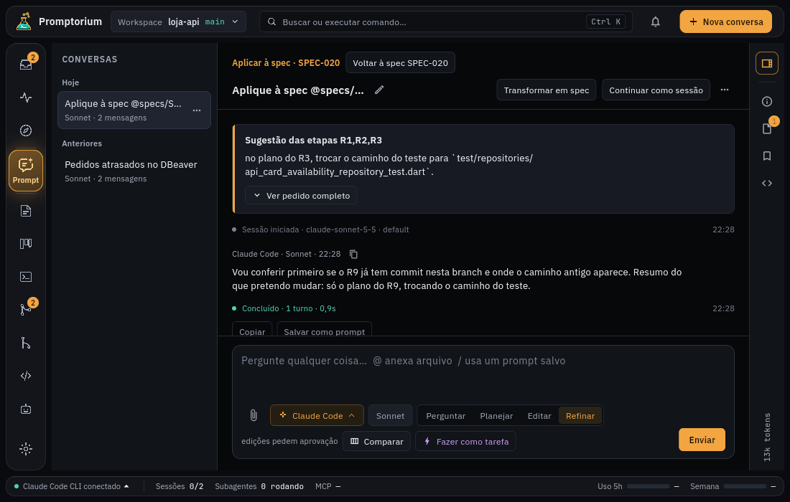

# Layout de Aplicar à spec

[Issue #317](https://github.com/mayroncachina/promptorium/issues/317)

## Telas

## Objetivo

Ao abrir **Aplicar à spec** a partir da sessão de uma etapa, a conversa começa com um título truncado e uma mensagem longa que mistura a sugestão com as instruções para o agente. A pessoa precisa reconhecer a spec de destino, as etapas de origem e a mudança proposta ao abrir a conversa.

## Requisitos

- R1 · No cabeçalho, mostrar **Aplicar à spec** e o código da spec de destino. Manter **Voltar à spec** visível e acessível por teclado, inclusive em janelas estreitas.
- R2 · Na abertura da conversa, destacar a sugestão e identificar as etapas de origem. Deixar o caminho do arquivo e as instruções do pedido disponíveis para consulta.
- R3 · Preservar o pedido enviado ao agente, incluindo a proteção dos requisitos já feitos e a instrução de resumir a mudança antes de editar.

## Critérios de aceitação

- [ ] Ao abrir a ação para uma spec com título longo, o cabeçalho identifica a spec e o botão de voltar funciona em janela estreita. [R1]
- [ ] Ao abrir a ação a partir de várias etapas, a sugestão e as etapas ficam legíveis e as instruções completas podem ser consultadas. [R2]
- [ ] O agente recebe as mesmas instruções de aplicação do fluxo atual. [R3]
