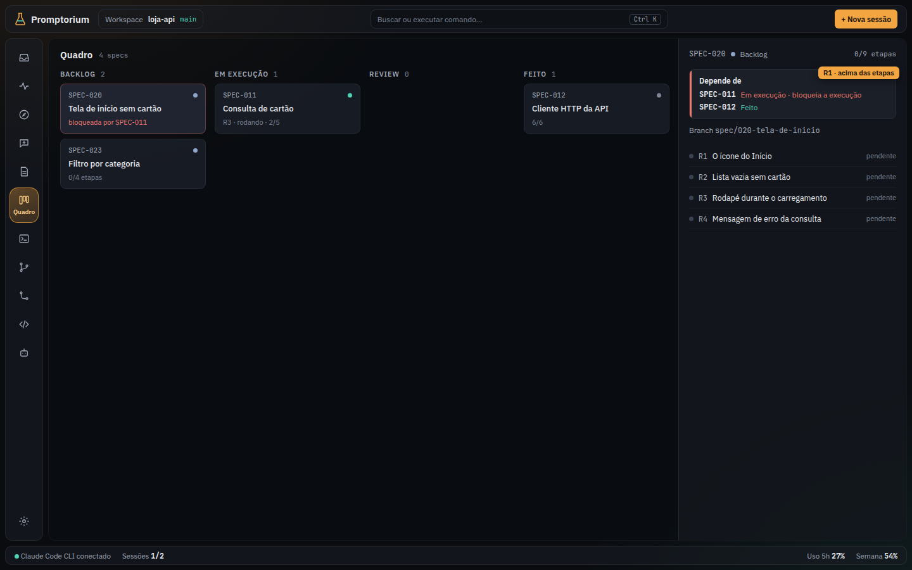
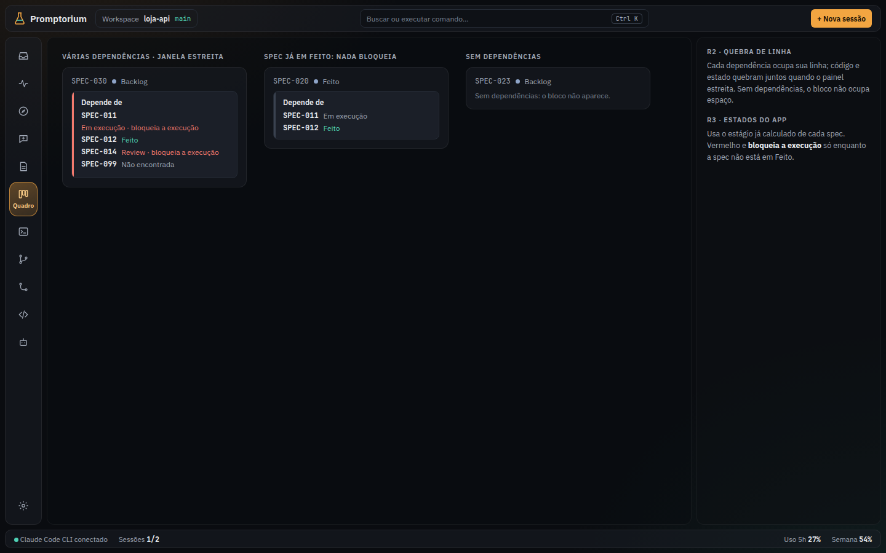

# Dependências mais visíveis na spec

[Issue #316](https://github.com/mayroncachina/promptorium/issues/316)

## Objetivo

No painel da spec, a dependência aparece numa linha pequena entre o status e as etapas. Dar a **Depende de** um lugar próprio ajuda a identificar o que precisa terminar antes de executar a spec.

## Requisitos

- R1 · Mostrar as dependências no cabeçalho da spec, acima das etapas, sob o rótulo **Depende de**. Identificar cada dependência pelo código e indicar em texto quando ela bloqueia a execução.
- R2 · Quando houver várias dependências, quebrar a lista em linhas. Em janela estreita, manter os códigos e estados legíveis. Ocultar o bloco quando a spec não tiver dependências.
- R3 · Usar as dependências e os estados já calculados pelo app. Atualizar a indicação quando o estado de uma dependência mudar.

## Critérios de aceitação

- [ ] Uma dependência fora de Feito aparece com seu código e indicação textual de bloqueio. [R1]
- [ ] Uma spec com várias dependências exibe todos os códigos em janela estreita, e uma spec sem dependências não ocupa espaço com o bloco. [R2]
- [ ] Quando a dependência vai para Feito, o bloco reflete o estado atualizado. [R3]
