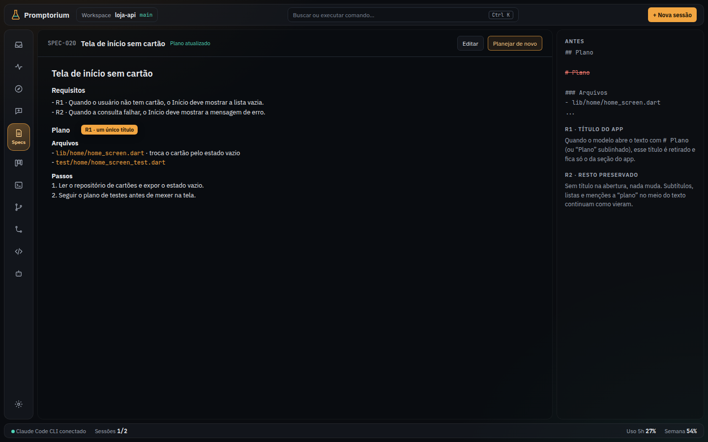

# Título único no plano da spec

[Issue #315](https://github.com/mayroncachina/promptorium/issues/315)

## Objetivo

Ao planejar uma spec com um modelo que já inclui o título **Plano**, o resultado pode exibir esse título duas vezes seguidas. A seção deve abrir com um único título e manter o conteúdo do plano.

## Requisitos

- R1 · Na composição do plano da spec, reconhecer o título **Plano** quando aparece na abertura do conteúdo trazido pelo modelo. Usar um único título para a seção apresentada.
- R2 · Se o modelo não trouxer o título na abertura, manter o título fornecido pelo app. Preservar subtítulos, listas, menções a “plano” no conteúdo e o texto do modelo salvo.

## Critérios de aceitação

- [ ] Planejar com um modelo que começa com o título **Plano** mostra um único título, seguido do conteúdo completo. [R1, R2]
- [ ] Planejar com um modelo sem título, ou sem modelo, continua mostrando a seção **Plano**. [R2]
- [ ] Uma menção a “plano” dentro do texto ou de um subtítulo permanece no resultado. [R2]
