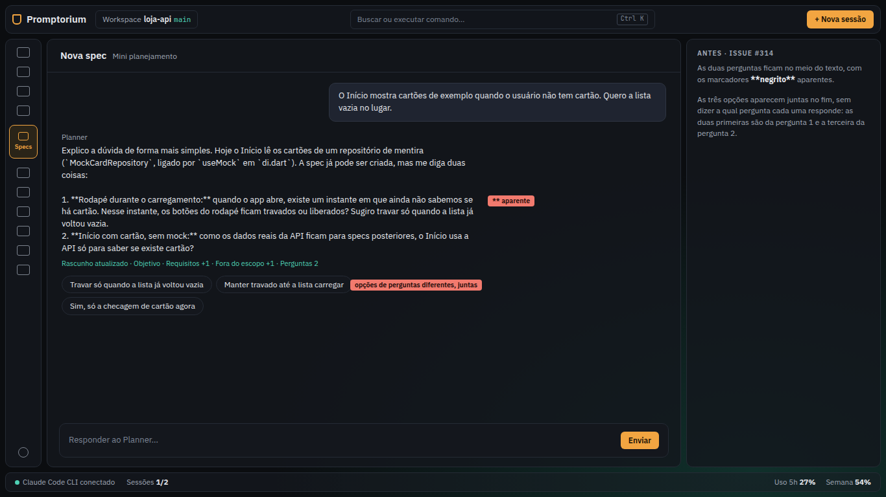
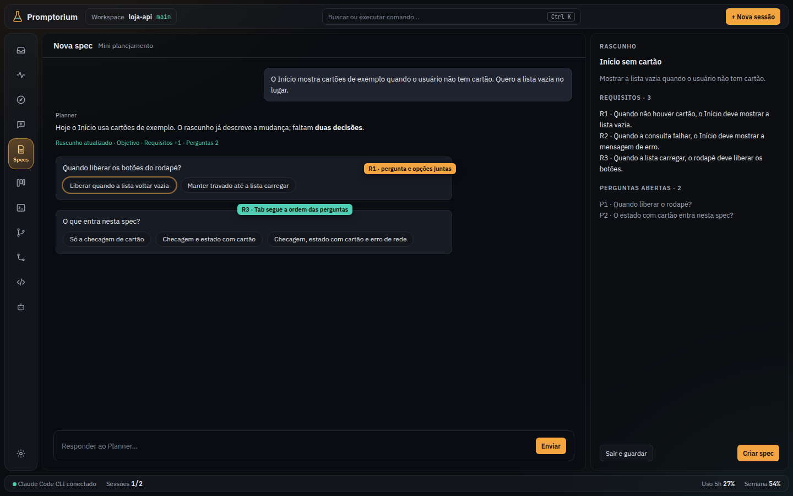
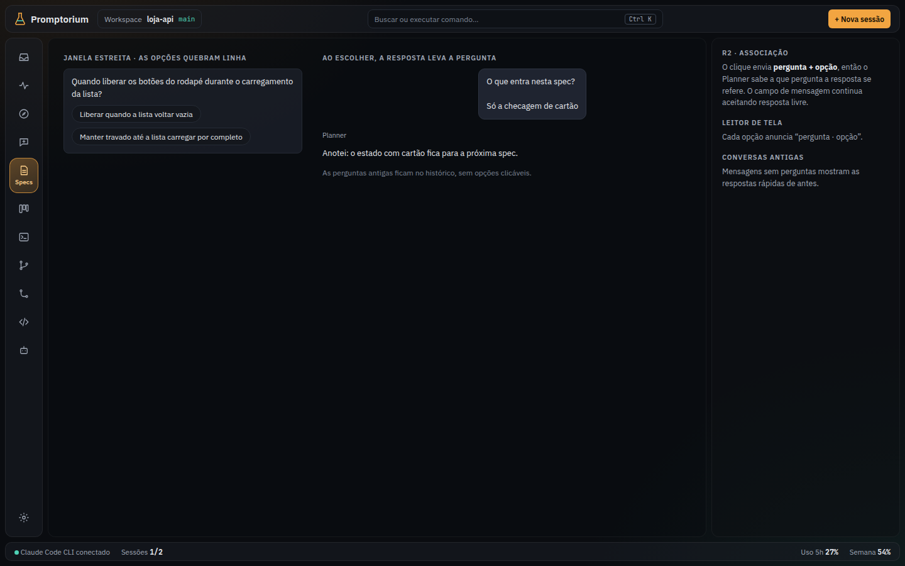
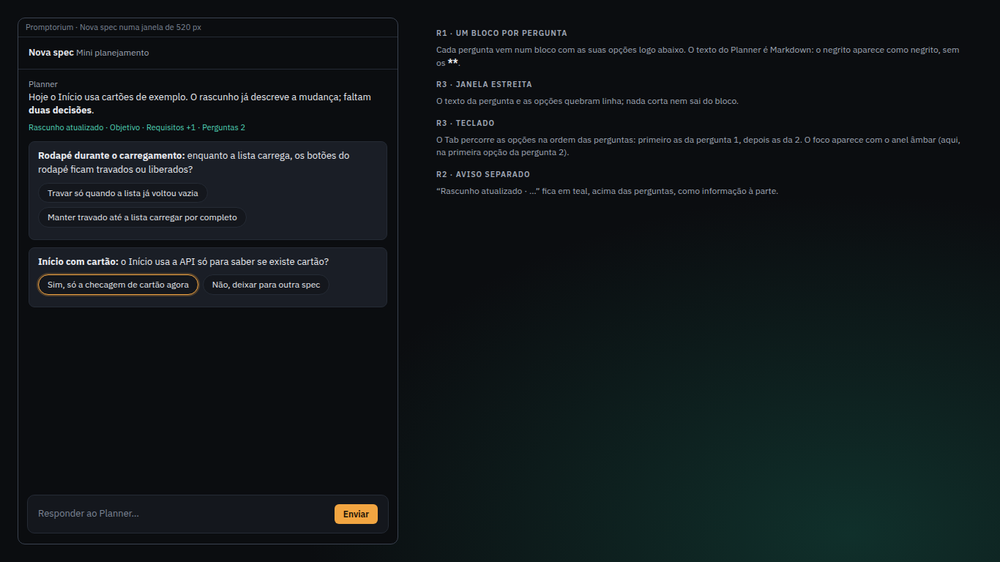
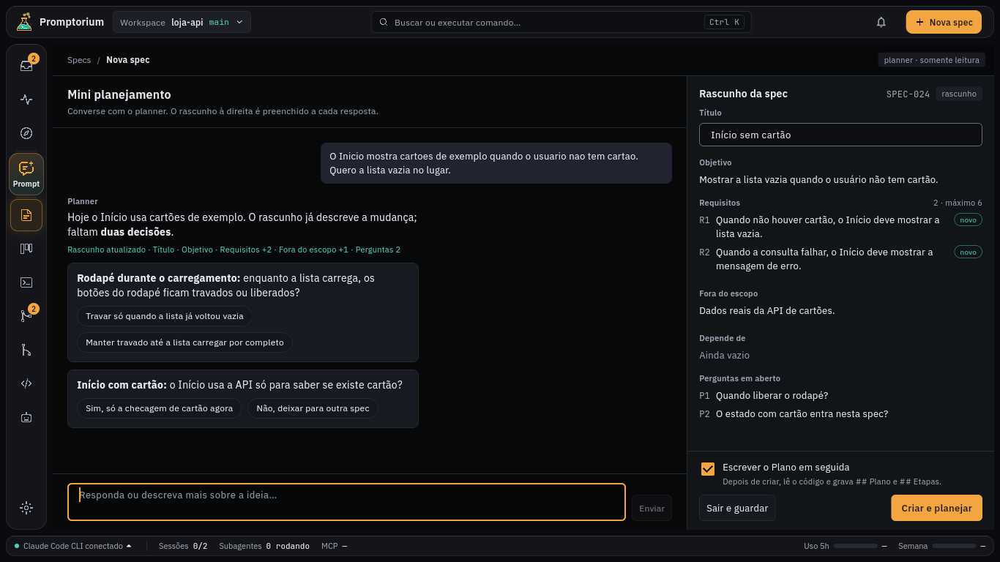
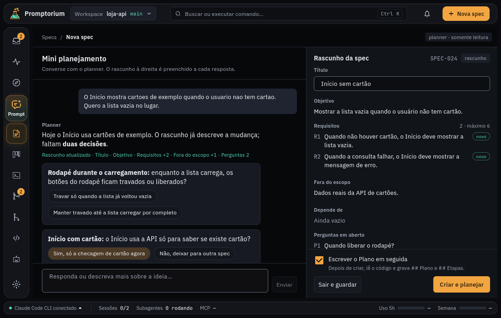
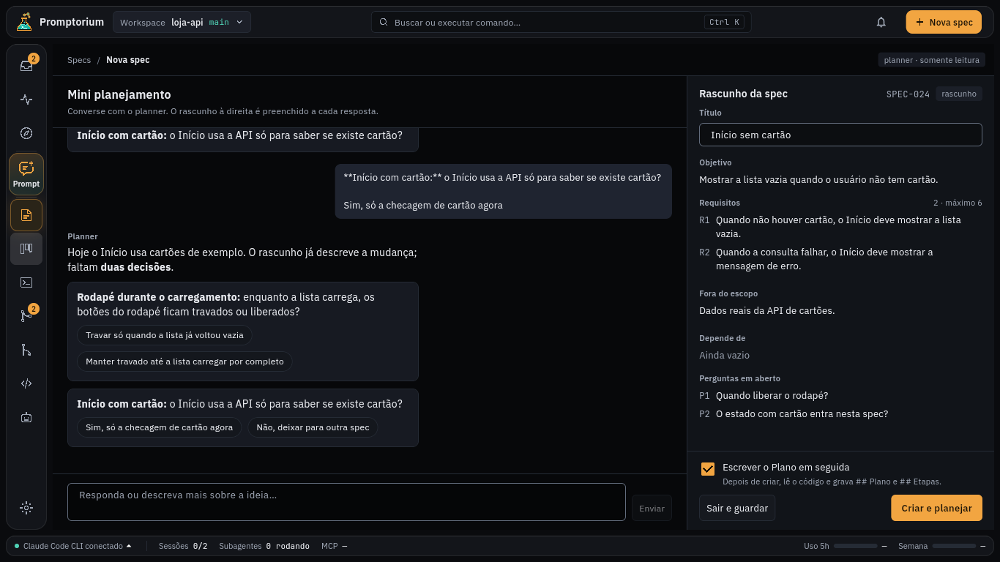

# Perguntas do mini planejamento

[Issue #314](https://github.com/mayroncachina/promptorium/issues/314)

## Telas

## Objetivo

Quando o Planner faz duas perguntas em uma resposta, as opções ficam juntas abaixo da mensagem. A pessoa precisa ler a mensagem inteira para descobrir a qual pergunta pertence cada opção.

## Requisitos

- R1 · No mini planejamento de **Nova spec**, mostrar as perguntas em blocos individuais, com o texto de cada pergunta e suas opções no mesmo bloco. Exibir a formatação Markdown da mensagem do Planner sem deixar os marcadores de negrito aparentes.
- R2 · Ao escolher uma opção, manter a associação com a pergunta correspondente. Preservar a resposta livre pelo campo de mensagem e manter o aviso de atualização do rascunho visível como informação separada das perguntas.
- R3 · Em janelas estreitas, deixar textos e opções quebrarem linha e manter o acesso por teclado na ordem das perguntas.

## Critérios de aceitação

- [ ] Uma resposta sobre rodapé durante o carregamento e início com cartão mostra dois blocos, cada um com suas próprias opções. [R1]
- [ ] Selecionar uma opção da segunda pergunta envia a resposta ligada à segunda pergunta. A pessoa ainda consegue responder pelo campo de mensagem. [R2]
- [ ] Em largura reduzida, perguntas e opções permanecem legíveis e podem ser percorridas por teclado. [R3]
