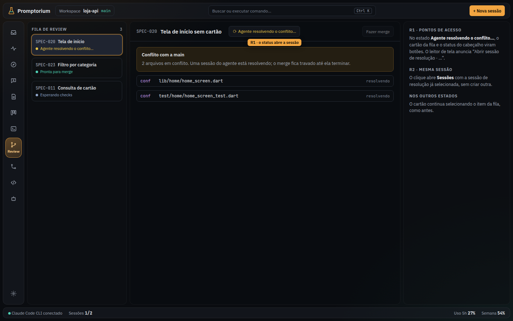
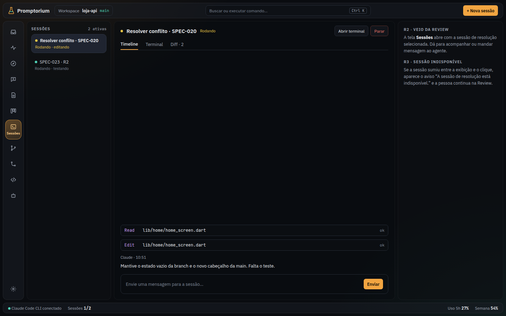

# Abrir a sessão de resolução de conflito

[Issue #312](https://github.com/mayroncachina/promptorium/issues/312)

## Objetivo

Enquanto o agente resolve um conflito, a Revisão mostra **Agente resolvendo o conflito…**. Clicar no cartão ou nesse texto deve levar à sessão aberta para aquele conflito.

## Requisitos

- R1 · No estado **Agente resolvendo o conflito…**, tornar o cartão e o texto do status pontos de acesso à sessão de resolução. A ação deve ter foco por teclado e um rótulo acessível que indique o destino.
- R2 · Abrir a tela **Sessões** com a sessão de resolução já existente selecionada, usando o vínculo da resolução com a sessão. Preservar as ações próprias dos botões dentro do cartão.
- R3 · Se a sessão deixar de estar disponível entre a exibição do status e o clique, informar a indisponibilidade e manter a pessoa na Revisão.

## Critérios de aceitação

- [ ] Com duas resoluções em curso, clicar no cartão ou no texto de uma abre a sessão correspondente, sem criar sessão adicional. [R1, R2]
- [ ] É possível abrir a sessão com o teclado, e os botões internos mantêm suas ações. [R1, R2]
- [ ] Se a sessão vinculada sumir antes do clique, a Revisão informa a indisponibilidade. [R3]
